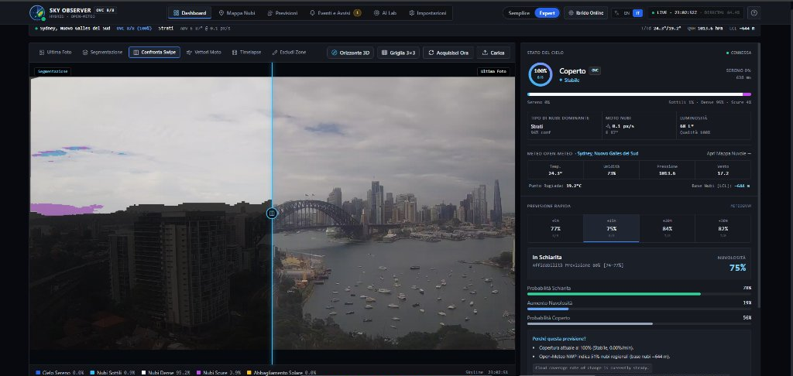
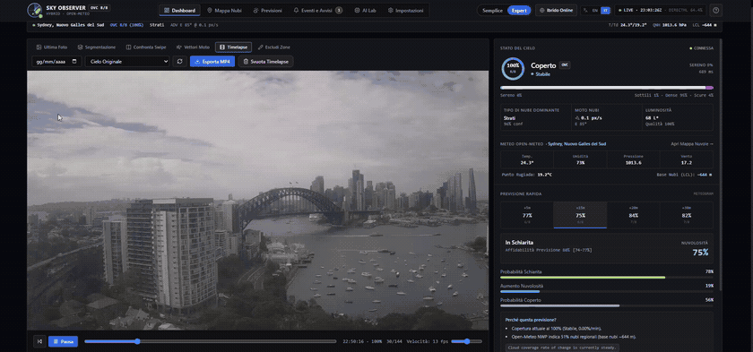
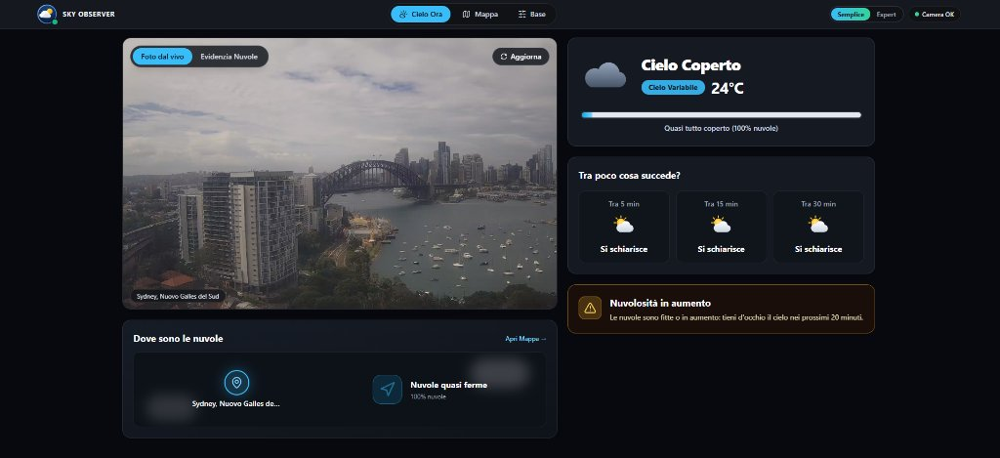
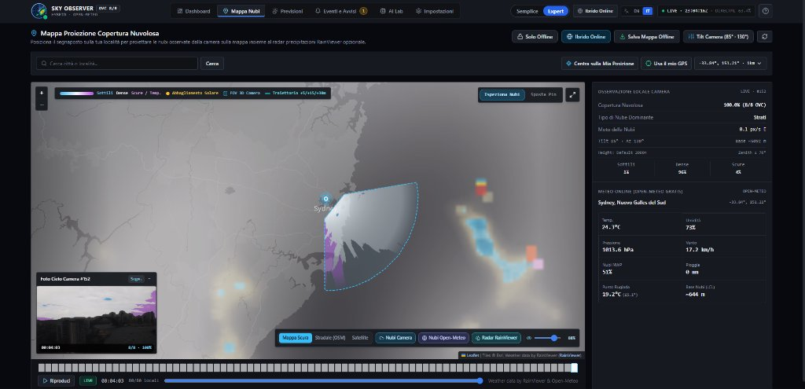
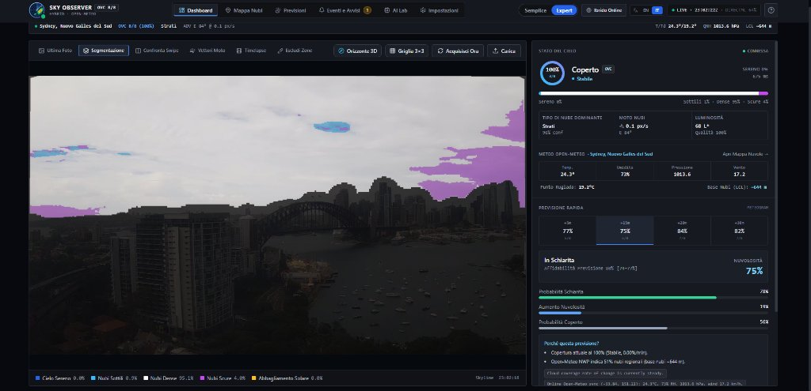
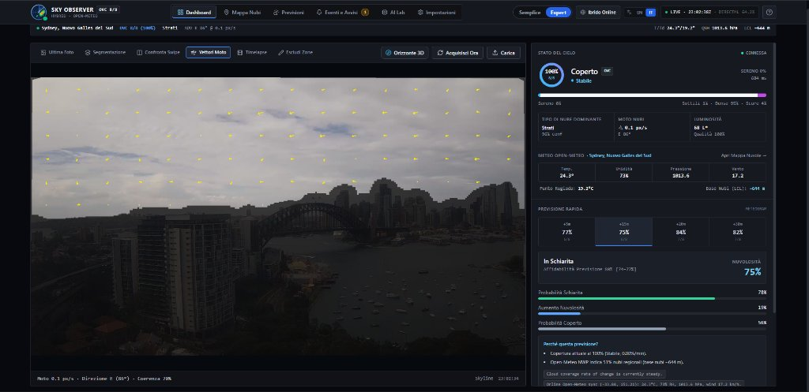
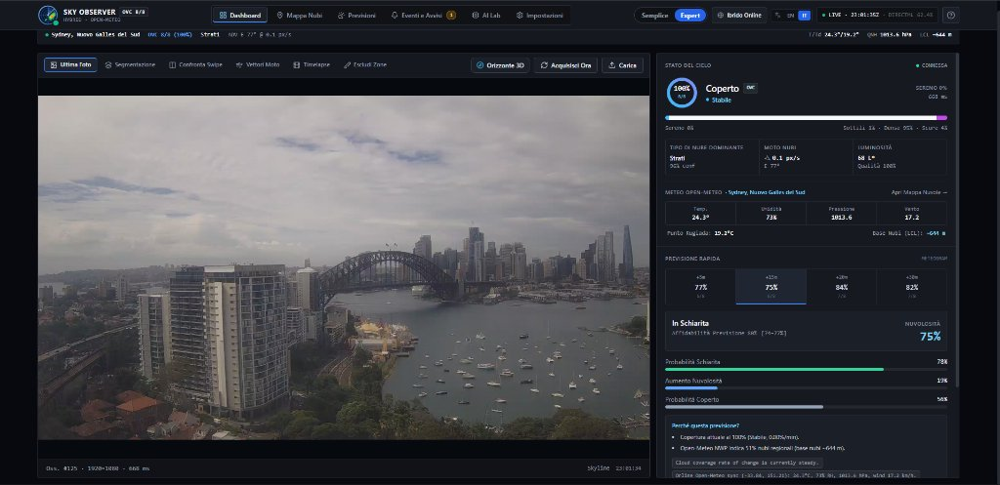
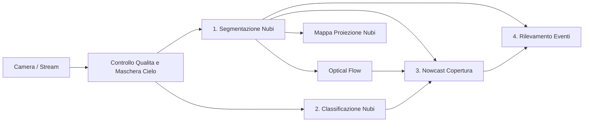

# Sky Observer

Applicazione self-hosted che stima la copertura nuvolosa da una camera puntata verso il cielo, la proietta su una mappa geografica delle nubi e produce nowcast della copertura nuvolosa a breve termine (5–20 min solo camera, fino a 60 min con NWP opzionale).

[](https://github.com/ak47siriano/sky-observer/actions/workflows/ci.yml)
[](LICENSE)
[](https://github.com/ak47siriano/sky-observer/releases)
[](pyproject.toml)

[English](README.md) · [Italiano](README.it.md)

---


*Dashboard in modalità Esperto: vista a confronto tra la maschera di segmentazione del cielo (a sinistra: classi di nubi sottili, dense e scure con edifici sotto l'orizzonte esclusi) e il fotogramma originale coperto (a destra), con telemetria della copertura nuvolosa e nowcast a breve termine.*

### Demo e Altre Viste dell'Interfaccia


*Riproduzione timelapse con passaggio dai fotogrammi originali alla sovrapposizione del flusso ottico delle nubi (146 frame acquisiti, edifici esclusi dalla maschera).*

<details>
<summary>Altre schermate (Modalità Semplice, Mappa Nubi, Segmentazione, Vettori Moto, Dashboard Originale)</summary>

| Modalità Semplice | Mappa Proiezione Nubi |
| :---: | :---: |
| <br>*Modalità Semplice: stato del cielo sintetico, riepilogo a 5/15/30 min e accesso rapido alla mappa.* | <br>*Mappa proiezione nubi: cono FOV della camera, proiezione con cutoff zenitale, riquadro PiP e layer opzionale RainViewer.* |

| Segmentazione Cielo | Vettori Moto Optical Flow |
| :---: | :---: |
| <br>*Sovrapposizione della segmentazione nuvolosa a schermo intero con maschera di esclusione ostacoli.* | <br>*Campo vettoriale optical flow calcolato esclusivamente sui pixel di cielo non mascherati.* |

| Fotogramma Originale (Dashboard Esperto) |
| :---: |
| <br>*Vista originale nella Dashboard Esperto con dettaglio copertura, sincronizzazione Open-Meteo e nowcast della copertura nuvolosa.* |

</details>

<!-- TODO: Questi screenshot e la registrazione demo provengono da uno stream web pubblico (SkylineWebcams). Sostituiscili con catture dalla tua camera se vuoi rilasciare tutti i media di esempio in docs/ direttamente sotto la tua licenza (es. CC0 o CC-BY-4.0). -->

---

## Cosa Fa e Cosa Non Fa

**Cosa fa:**
- Acquisisce fotogrammi da camere IP in LAN (`HTTP snapshot`, `MJPEG`, `RTSP`), webcam USB locali, cartelle AllSky, caricamenti manuali o stream web pubblici opzionali.
- Segmenta i pixel del cielo in classi nuvolose su CPU senza GPU (`radiometric-physics-v1`), con backend PyTorch opzionali (`DeepLabV3-MobileNetV3`, linear probe `DINOv3`, `CloudSegUNet`).
- Stima il movimento delle nubi tra fotogrammi con optical flow e calcola nowcast della copertura nuvolosa (`+5`, `+15`, `+20` min solo camera), confrontati costantemente con la baseline di persistenza.
- Proietta la maschera nuvolosa della camera su una mappa geografica delle nubi usando azimut, elevazione, rollio, campo visivo e una quota stimata della base delle nubi.
- Espone API REST (`/api/sky-state`), WebSocket (`/ws/live`), metriche Prometheus (`/metrics`) e auto-discovery MQTT opzionale per Home Assistant.

**Cosa non fa:**
- **Non** misura l'intensità della precipitazione né rileva la pioggia in autonomia. Il layer di precipitazione richiede di attivare la modalità Ibrida con un provider esterno (RainViewer o LibreWXR self-hosted).
- **Non** sostituisce un radar meteorologico. La mappa locale è una proiezione ottica della sky camera.
- **Non** misura la quota della base delle nubi da una singola camera. Le posizioni sulla mappa sono stime geometriche basate su una quota configurata o su un'approssimazione LCL (`125 * (T - Td)`).
- **Non** misura localmente temperatura, pressione o umidità.
- **Non** produce previsioni meteo affidabili su più ore da una singola camera con campo visivo stretto.

---

## Stato del Progetto

**Alpha / sperimentale.** La pipeline base di osservazione funziona su CPU ed è coperta da test automatici; l'addestramento neurale e alcune funzioni avanzate sono sperimentali.

- **Funzionante e testato:** Acquisizione camera (`HTTP`, `MJPEG`, `RTSP`, `USB`, `AllSky`, simulazione Demo), maschere di esclusione ostacoli a pennello/poligono, segmentazione `radiometric-physics-v1`, advezione con optical flow e calcolo dello skill score contro la persistenza, archiviazione SQLite con retention e quota disco, modalità Offline predefinita, autenticazione via token API, REST `/api/sky-state` e metriche Prometheus `/metrics`.
- **Sperimentale o parziale:** Fine-tuning locale PyTorch e Location Auto-Train, addestramento linear probe `DINOv3` giorno/notte, modelli sequenziali `TemporalSkyConvGRU` e `SkyEventClassifier-GRU`, rilevamento notturno delle nubi e triangolazione stereo multi-camera (`POST /api/camera/stereo/triangulate` calcola la geometria 3D da coppie di angoli azimut/elevazione, senza matching automatico tra fotogrammi di due camere).

---

## Requisiti

L'accelerazione GPU (CUDA, ROCm, DirectML o Apple MPS) è opzionale. La segmentazione radiometrica predefinita e il nowcast con optical flow girano su CPU.

| Livello | CPU | RAM | Disco | OS | GPU |
| :--- | :--- | :--- | :--- | :--- | :--- |
| Minimi | 2 core (x86_64 o ARM64) | 4 GB | 2 GB liberi | Linux, Windows 10/11, macOS | Nessuna (solo CPU) |
| Consigliati | 4+ core | 8 GB | 10+ GB liberi | Linux, Windows 10/11, macOS | Opzionale (4+ GB VRAM per fine-tuning neurale) |

---

## Avvio Rapido

### Docker (consigliato)

```bash
cp .env.example .env
docker compose up -d --build
```

Apri `http://localhost:8080`. L'applicazione si avvia in **modalità Offline** in ascolto su `127.0.0.1`, con una sorgente **Demo Sky Simulation** integrata nel caso non sia ancora collegata una camera fisica.

Note:
- **Webcam USB / Iriun (solo Linux):** Il `docker-compose.yml` standard supporta solo stream di rete e cartelle montate. Su Linux, per passare `/dev/video0`, avvia `docker compose -f docker-compose.yml -f docker-compose.usb.yml up -d`. Docker Desktop su Windows e macOS non inoltra `/dev/video*` nativamente: usa uno stream di rete oppure l'installazione nativa.
- **GPU NVIDIA:** Avvia `docker compose -f docker-compose.yml -f docker-compose.gpu.yml up -d --build` (usa wheel PyTorch CUDA 12.4).
- **Accesso da telefono / LAN e installazione PWA:** Prima di impostare `SKYOBSERVER_HOST=0.0.0.0`, imposta un `SKYOBSERVER_API_TOKEN` robusto in `.env` e servi l'app in HTTPS tramite `docker compose -f docker-compose.yml -f docker-compose.https.yml up -d` (Caddy) oppure Tailscale/mkcert. Vedi [docs/INSTALLATION.md](docs/INSTALLATION.md).

### Installazione nativa (Linux / macOS — Bash)

```bash
python3 -m venv .venv
source .venv/bin/activate
pip install --index-url https://download.pytorch.org/whl/cpu torch torchvision
pip install -r backend/requirements.txt

cd frontend && npm ci && npm run build && cd ..

PYTHONPATH=backend uvicorn app.main:app --host 127.0.0.1 --port 8080
```

### Installazione nativa (Windows — PowerShell)

```powershell
python -m venv .venv
.\.venv\Scripts\Activate.ps1
pip install --index-url https://download.pytorch.org/whl/cpu torch torchvision
pip install -r backend/requirements.txt

cd frontend; npm ci; npm run build; cd ..

$env:PYTHONPATH = "backend"
.\.venv\Scripts\python.exe -m uvicorn app.main:app --host 127.0.0.1 --port 8080
```

Sia Docker sia l'installazione nativa ascoltano sulla porta `8080` di default.

---

## Configurazione

Copia `.env.example` in `.env` per modificare i valori predefiniti. Le impostazioni dettagliate di camera, geometria, storage e MQTT si trovano in `config/config.yaml`.

| Variabile | Default | Descrizione |
| :--- | :--- | :--- |
| `SKYOBSERVER_OFFLINE_MODE` | `true` | Modalità Offline predefinita. Blocca tutte le chiamate esterne verso meteo, geocoding, METAR, radar e stream web pubblici. |
| `SKYOBSERVER_HOST` | `127.0.0.1` | Interfaccia host esposta da Docker (o da `uvicorn`). Mantieni `127.0.0.1` finché non metti in sicurezza l'accesso LAN. |
| `SKYOBSERVER_PORT` | `8080` | Porta HTTP per API e interfaccia web. |
| `SKYOBSERVER_API_TOKEN` | *(vuoto)* | Token condiviso che protegge `/api/*`, `/ws/live` e `/metrics` e richiede conferma esplicita sulle azioni distruttive. |
| `SKYOBSERVER_SOURCE_ALLOWLIST` | *(vuoto)* | Lista opzionale (separata da virgole) di host, domini o CIDR consentiti per gli URL camera (protezione SSRF). |
| `SKYOBSERVER_DEVICE` | `auto` | Dispositivo di calcolo (`auto`, `cpu`, `cuda`, `rocm`, `directml`, `mps`). |
| `SKYOBSERVER_DATA_DIR` | `/data` (Docker) / `./data` (nativo) | Cartella per DB SQLite, immagini, maschere, timelapse, dataset e file `.pmtiles` locali. |
| `SKYOBSERVER_VIDEO_DEVICE` | `/dev/video0` | Dispositivo V4L2 Linux usato da `docker-compose.usb.yml`. |
| `SKYOBSERVER_LAN_HOST` | `localhost` | IP o hostname LAN per il certificato TLS Caddy in `docker-compose.https.yml`. |

**Modalità Offline vs. Modalità Ibrida:**
- **Modalità Offline (`SKYOBSERVER_OFFLINE_MODE=true`, default):** Nessun traffico di rete verso l'esterno. La mappa delle nubi mostra una griglia geografica locale o eventuali archivi Protomaps `.pmtiles` copiati in `data/map_tiles/`. Il nowcast è limitato agli orizzonti solo-camera (`+5`, `+15`, `+20` min).
- **Modalità Ibrida (`SKYOBSERVER_OFFLINE_MODE=false`):** Abilita i dati opzionali Open-Meteo (estendendo gli orizzonti a `+30`/`+60` min e stimando l'LCL), i tile radar passati di RainViewer (o LibreWXR self-hosted), i tile cartografici online, il confronto METAR e gli stream `web_stream` pubblici.

---

## Come Funziona



1. **Segmentazione delle nubi:** Riceve un fotogramma del cielo e la maschera di esclusione degli ostacoli, e produce una mappa pixel-per-pixel delle classi nuvolose (5 classi interne o proiezione ridotta a 3 classi: `clear_sky`, `cloud`, `thick_cloud`, più `255` per i pixel non-cielo). Funziona subito su CPU con `radiometric-physics-v1`, con supporto opzionale a checkpoint neurali `DeepLabV3-MobileNetV3`, linear probe `DINOv3` o `CloudSegUNet`. Serve per calcolare la percentuale di copertura e costruire la proiezione della sky camera sulla mappa.
2. **Classificazione delle nubi:** Riceve il fotogramma insieme alle feature radiometriche, di copertura e di tessitura, e restituisce una distribuzione di probabilità sul tipo di nube (tassonomia ridotta a 5 macro-classi allineata a SWIMCAT più etichette euristiche dettagliate e tag di stato cielo opzionali come `fog`, `rain`, `contrails`, restituendo `unknown` sotto la soglia di confidenza). Serve per descrivere la struttura nuvolosa e guidare la stima predefinita della quota nuvolosa in assenza di dati NWP.
3. **Nowcast della copertura nuvolosa:** Riceve le maschere di segmentazione recenti, i campi di moto optical flow e la sequenza storica delle osservazioni, e produce la copertura nuvolosa prevista a `+5`, `+15` e `+20` min (`+30`/`+60` min solo con Open-Meteo NWP). Combina l'advezione semi-Lagrangiana con optical flow (con percentili di incertezza `p10`–`p90`) e un modello sperimentale `TemporalSkyConvGRU`, sempre confrontati contro la persistenza.
4. **Rilevamento eventi:** Riceve le variazioni tra fotogrammi di copertura, luminanza e movimento, e genera avvisi operativi e del cielo (rapido aumento nuvoloso, schiarita, oscuramento, ostruzione camera). Combina regole deterministiche, feedback utente (conferma, falso allarme o segnalazione evento mancato) e un classificatore sequenziale sperimentale `SkyEventClassifier-GRU`.

Dettagli implementativi, dimensioni dei tensori e schema di archiviazione sono descritti in [docs/ARCHITECTURE.md](docs/ARCHITECTURE.md).

---

## Accuratezza e Valutazione

La valutazione si esegue con `PYTHONPATH=backend python scripts/evaluate.py` (split cronologici a giornate intere e baseline esplicite) e `PYTHONPATH=backend python scripts/evaluate_nowcast.py --from-db`.

**Stato attuale:** La valutazione su un Golden Set etichettato manualmente dalla propria camera reale **non è ancora completata**. I numeri nella tabella seguente derivano solo dalle sequenze sintetiche incluse nella repository; servono come controllo anti-regressione in CI e non vanno interpretati come accuratezza sul campo.

| Task | Set di valutazione (attuale) | Modello | Risultato misurato | Baseline naive |
| :--- | :--- | :--- | :--- | :--- |
| Segmentazione | `bundled_synthetic_sky_18f` (`n=18`) | `radiometric-physics-v1` | mIoU binario `0.8725`, MAE copertura `5.02%` | Soglia R/B fissa: mIoU `0.8628`, MAE `7.09%`; Otsu: mIoU `0.8375`, MAE `7.78%` |
| Classificazione | `bundled_synthetic_sky_18f` (giorno held-out, `n=6`) | `physical-heuristic-v1` | Accuratezza `0.6667`, Macro F1 `0.5714` | kNN 12 feature: Acc `0.8333`, F1 `0.7778`; Maggioranza: Acc `0.1667` |
| Nowcast copertura (+5 min) | `bundled_panoramic_cloud_front_14f` (`n=11`) | Advezione ibrida | MAE `6.49%`, Skill `+0.48` | Persistenza: MAE `12.59%`; Trend lineare: MAE `5.92%` (`+0.53`) |
| Nowcast copertura (+15 min) | `bundled_panoramic_cloud_front_14f` (`n=7`) | Advezione ibrida | MAE `26.37%`, Skill `+0.36` | Persistenza: MAE `41.27%`; Trend lineare: MAE `16.77%` (`+0.59`) |
| Nowcast copertura (+20 min) | `bundled_panoramic_cloud_front_14f` (`n=5`) | Advezione ibrida | MAE `37.66%`, Skill `+0.31` | Persistenza: MAE `54.58%`; Trend lineare: MAE `23.69%` (`+0.57`) |

<!-- TODO: Creare un Golden Set di 150–300 fotogrammi etichettati dalla propria camera con scripts/build_golden_set.py, eseguire scripts/evaluate.py --datasets-dir data/datasets e sostituire/affiancare le righe sintetiche sopra con i risultati su camera reale e su dataset pubblici (SWIMSEG/SWINySEG). -->

Lo skill score è definito come `1 - MAE_modello / MAE_persistenza` (valori `<= 0` indicano nessun miglioramento rispetto alla persistenza). Metriche stratificate per condizione e valutazione eventi sono riportate in [docs/MODEL_CARD.md](docs/MODEL_CARD.md).

---

## Limitazioni Note

- **Incertezza della quota delle nubi con una sola camera:** Una camera monoculare non misura l'altitudine delle nubi. Qualsiasi errore sulla quota stimata o calcolata via LCL si propaga linearmente sulla distanza proiettata (`d = H * tan(zenith)`). L'errore cresce rapidamente verso l'orizzonte: la proiezione è tagliata a `<= 75°` di zenit (`>= 15°` di elevazione) e sfuma l'opacità con l'incertezza. Per misurare la quota reale servono due camere distanziate (`POST /api/camera/stereo/triangulate`).
- **Orizzonte limitato su ottiche strette:** Con un obiettivo smartphone da ~70°, le nubi attraversano l'inquadratura in 5–15 minuti. Gli orizzonti in cui `>= 70%` delle nubi esce dal campo visivo o lo skill storico non batte la persistenza vengono marcati `low_reliability`.
- **Notte, crepuscolo, abbagliamento e gocce sull'obiettivo:** Il rilevamento notturno dipende dal bagliore del cielo o dalle stelle visibili ed è meno affidabile. Sole diretto, viraggi cromatici al crepuscolo, riflessi su vetri interni e gocce sulla lente degradano segmentazione e classificazione (segnalati dal controllo qualità quando rilevati, ma non eliminati).
- **Esposizione e bilanciamento del bianco automatici:** Gli smartphone regolano continuamente esposizione e bilanciamento del bianco, alterando il rapporto R/B e la luminanza. La normalizzazione AE/AWB riduce le oscillazioni ma non equivale a un'esposizione manuale bloccata.
- **Auto-train sperimentale:** L'auto-addestramento non supervisionato può introdurre drift nel tempo. Location Auto-Train esclude il Golden Set bloccato, limita le pseudo-label al 50% del batch e scarta i checkpoint che peggiorano in qualsiasi categoria di cielo, ma richiede comunque revisione umana.

---

## Sicurezza

- **Non esporre Sky Observer direttamente su Internet.** Il servizio è pensato per uso locale (`localhost`) o in LAN privata / VPN (es. Tailscale o WireGuard).
- Di default Docker espone il servizio solo su `127.0.0.1:8080`.
- Prima di esporlo in LAN, imposta `SKYOBSERVER_API_TOKEN`, configura `SKYOBSERVER_SOURCE_ALLOWLIST` se vuoi limitare gli host consentiti per le camere e abilita HTTPS (`docker-compose.https.yml` o reverse proxy).
- Vedi [SECURITY.md](SECURITY.md) per modello di minaccia, header di autenticazione, protezioni SSRF e segnalazione vulnerabilità.

---

## Documentazione

- [docs/INSTALLATION.md](docs/INSTALLATION.md) — Requisiti hardware, override Docker (GPU, USB, Caddy HTTPS), setup nativo e installazione all'aperto
- [docs/ARCHITECTURE.md](docs/ARCHITECTURE.md) — Strati della pipeline, backend di segmentazione plug-in e archiviazione SQLite/disco
- [docs/MODEL_CARD.md](docs/MODEL_CARD.md) — Dettagli dei modelli, gate anti-drift, tabelle di valutazione riproducibili e riferimenti bibliografici
- [docs/API.md](docs/API.md) — Endpoint REST, WebSocket (`/ws/live`), Home Assistant e Prometheus `/metrics`
- [docs/DATASETS.md](docs/DATASETS.md) — Dataset pubblici, tabelle di conversione delle classi e formati di importazione
- [docs/TRAINING.md](docs/TRAINING.md) — Fine-tuning locale, creazione del Golden Set e flusso Auto-Train
- [docs/TROUBLESHOOTING.md](docs/TROUBLESHOOTING.md) — Diagnostica camera, fallback GPU e problemi comuni
- [SECURITY.md](SECURITY.md) — Modello di minaccia, autenticazione via token e gestione credenziali
- [CHANGELOG.md](CHANGELOG.md) — Cronologia delle versioni

---

## Contribuire

Contributi, segnalazioni di bug e dataset di valutazione sono benvenuti. Consulta [CONTRIBUTING.md](CONTRIBUTING.md) per configurazione dell'ambiente di sviluppo e convenzioni.

Per segnalare un bug includi:
- Versione di Sky Observer o hash del commit (`git rev-parse --short HEAD`)
- Sistema operativo e metodo di installazione (Docker Compose o Python nativo)
- Tipo di sorgente camera (`http_snapshot`, `mjpeg_stream`, `rtsp`, `webcam_device`, `allsky_folder` o `web_stream`)
- Log del backend pertinenti e passi per riprodurre il problema

---

## Licenza e Crediti

- **Codice sorgente:** Rilasciato sotto [Licenza MIT](LICENSE).
- **Dataset e pesi addestrati:** Sky Observer include documentazione e adattatori per dataset pubblici di immagini del cielo (tra cui **SWIMSEG**, **SWINSEG**, **SWINySEG**, **WSISEG**, **SWIMCAT**, **CCSN**, **MGCD/GCD** e **LenghuSky-8**). Questi dataset **non** sono inclusi nella repository e sono soggetti alle rispettive licenze (spesso solo uso accademico o non commerciale). I pesi addestrati su dataset di terze parti o basati su backbone esterni (come **DINOv3**) ereditano i vincoli di licenza originali: verifica sempre le condizioni alla fonte prima di ridistribuire i pesi. Vedi [docs/DATASETS.md](docs/DATASETS.md).
- **Attribuzioni dei servizi esterni (usati solo in modalità Ibrida):**
  - Dati meteo e geocoding: [Open-Meteo](https://open-meteo.com/) (CC BY 4.0)
  - Tile cartografici: contributori [OpenStreetMap](https://www.openstreetmap.org/copyright) (ODbL), Esri World Imagery / Dark Gray Canvas, oppure archivi [Protomaps](https://protomaps.com/) `.pmtiles` installati localmente
  - Layer opzionale radar precipitazioni: [RainViewer](https://www.rainviewer.com/api.html) (solo frame radar passati, soggetti ai limiti del piano gratuito) oppure LibreWXR self-hosted configurato dall'utente
  - Confronto METAR opzionale: NOAA Aviation Weather Center
- **Immagini di esempio:** <!-- TODO: Indicare la licenza di docs/screenshots/*.png una volta sostituiti con scatti originali della propria camera. -->
