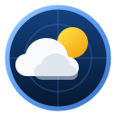
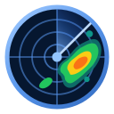
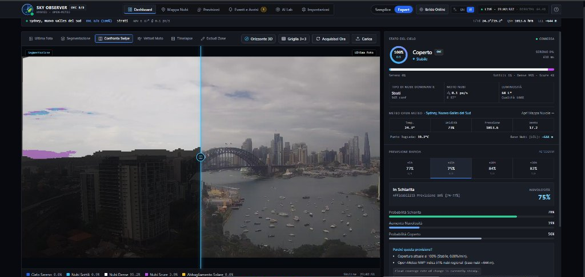

<div align="center">

<p>
  
  &nbsp;&nbsp;&nbsp;&nbsp;
  
</p>

# Sky Observer

**Local-first AI sky observatory, projected cloud cover map, and short-term optical-flow nowcasting from any smartphone, USB/RTSP camera, ESP32-CAM, or AllSky feed.**

*Runs 100% offline on CPU out of the box via calibrated radiometric physics (`radiometric-physics-v1`), with an instant **`Simple` ↔ `Expert`** mode switch (and adaptive Doppler Scope brand icon), optional PyTorch segmentation backends (`DeepLabV3`, `DINOv3` linear probe, `CloudSegUNet`), honest persistence-baselined nowcasting, and Home Assistant integration.*

[](https://github.com/ak47siriano/sky-observer/actions/workflows/ci.yml)
[](LICENSE)
[](pyproject.toml)
[](https://github.com/ak47siriano/sky-observer/releases)

</div>

---

## Live Walkthrough

<p align="center">
  
</p>

> *Real capture cycling **Original Sky -> Calibrated Segmentation -> Optical Flow Motion Vectors -> Compare Swipe -> Projected Cloud Cover Map + RainViewer Precipitation Radar**.*

---

## Key Capabilities

| Area | Implementation |
| :--- | :--- |
| **Dual UI Modes (`Simple` ↔ `Expert`)** | Persistent 1-click switch in the top header with dynamic **Doppler Scope** brand logo & favicon: **Simple Mode** gives an at-a-glance visual sky verdict, clean cloud/rain map, and basic setup; **Expert Mode** unlocks full METAR/SYNOP telemetry, compare swipe, motion vectors, forecasting, and Model Lab. |
| **Zero-GPU Default Segmentation** | `radiometric-physics-v1` (CIE-Lab + Red/Blue ratio + AWB compensation + sun-glare & dark-base guards) runs on a **4 GB RAM CPU-only PC** with no GPU or downloaded weights, and can be reactivated anytime with 1 click (`POST /api/models/deactivate`). |
| **Pluggable Neural Backends** | Optional **daytime `DeepLabV3-MobileNetV3`** (`torchvision`, BSD-3-Clause), **day/night `DINOv3-LinearProbe`** (LenghuSky-8-inspired frozen ViT + `1x1 Conv` probe trained on 50–100 local frames via [`scripts/train_dinov3_probe.py`](scripts/train_dinov3_probe.py)), and `CloudSegUNet`. Default `[baseline-default]` checkpoints are shielded from storage purges and pruning. |
| **Honest Nowcasting & Skill Score** | Semi-Lagrangian optical-flow cloud mask advection + perturbed-flow ensemble (`cover_p10`–`cover_p90`, `fov_exit_fraction`, `GET /api/forecast/advected-mask.png`) benchmarked against **Persistence** (`skill = 1 - MAE_model / MAE_persistence`) with explicit `low_reliability` horizon warnings. |
| **Projected Cloud Cover Map** | Reprojects local camera cloud classes onto dark/OSM/satellite Leaflet tiles with configurable **zenith cutoff (`<= 70 deg`)**, distance/zenith uncertainty opacity fade, and optional **RainViewer precipitation radar** + **Open-Meteo** NWP fusion. |
| **Low-Cost Hardware QC & Night Mode** | Detects indoor window reflections, smartphone AE/AWB jumps, localized raindrops/smudges, and heavy 8x8 JPEG blockiness; switches automatically across `day` / `twilight` / `night` regimes with moon phase/visibility and DoG bright-star clarity cues. |
| **Hardware-Free Calibration** | Auto-horizon & roll detection from frames, Android IP Webcam `/sensors.json` reader, solar-in-FOV azimuth refinement, and 1-click automatic sky-vs-obstacle exclusion mask proposal. |
| **Anti-Drift Local Auto-Train** | Permanent fixed holdout validation manifest (`fixed_holdout.json`) + promotion gate that keeps regressing checkpoints in standby instead of overwriting the active model. |
| **Smart-Home, Solar PV & IoT** | Ultra-fast `GET /api/sky-state`, optional **Solar GHI / PV output & ramp-event alerts** (`GET /api/solar/pv`), optional **Home Assistant MQTT Auto-Discovery**, plus 1-click presets for **Android IP Webcam**, **ESP32-CAM**, **Raspberry Pi Camera**, and **AllSky** folders. |

---

## Screenshots

### 1. Live Segmentation Compare Swipe & Short-Term Nowcast


### 2. Projected Cloud Cover Map + Optional RainViewer Radar


### 3. Optical Flow Cloud Advection Vectors


---

## Quick Start

Sky Observer ships with a **single unified `Dockerfile`** (FastAPI serves the pre-built React PWA directly on port **`8080`**), **CPU-only PyTorch wheels** by default, and **Offline-First mode enabled by default (`SKYOBSERVER_OFFLINE_MODE=true`)** with zero outbound requests unless you opt into Hybrid Mode (`SKYOBSERVER_OFFLINE_MODE=false` in `.env` or via the in-app toggle).

### Option 1: Docker Compose (Recommended, Unified Slim CPU Image)
```bash
cp .env.example .env
docker compose up -d --build
```
Open **`http://localhost:8080`** (bound to `127.0.0.1` by default).

- **Standard compose camera sources**: supports **network sources only** (`http_snapshot` / IP Webcam, `mjpeg_stream`, `rtsp`, `web_stream`, or a mounted `allsky_folder`).
- **Linux USB / Iriun webcam passthrough**:
  ```bash
  docker compose -f docker-compose.yml -f docker-compose.usb.yml up -d
  ```
  *(On Windows/macOS, Docker Desktop does not pass `/dev/video*` natively — use a network stream or Option 2/3 below.)*
- **NVIDIA GPU (CUDA 12.4 wheels)**:
  ```bash
  docker compose -f docker-compose.yml -f docker-compose.gpu.yml up -d --build
  ```
- **LAN & Mobile PWA over HTTPS**: Service Workers and iOS/Android PWA installation require HTTPS on non-localhost IP addresses. Set `SKYOBSERVER_HOST=0.0.0.0` and `SKYOBSERVER_LAN_HOST=<your-lan-ip>` in `.env` *(enable API token authentication before exposing on a shared LAN)* and start with Caddy HTTPS (or use **mkcert** / **Tailscale**, see [`docs/INSTALLATION.md`](docs/INSTALLATION.md)):
  ```bash
  docker compose -f docker-compose.yml -f docker-compose.https.yml up -d
  ```

### Option 2: Native Local Setup (Linux / macOS — Bash)
```bash
python3 -m venv .venv
source .venv/bin/activate
pip install --index-url https://download.pytorch.org/whl/cpu torch torchvision
pip install -r backend/requirements.txt

cd frontend && npm ci && npm run build && cd ..

PYTHONPATH=backend uvicorn app.main:app --host 127.0.0.1 --port 8080
```

### Option 3: Native Local Setup (Windows — PowerShell)
```powershell
python -m venv .venv
.\.venv\Scripts\Activate.ps1
pip install --index-url https://download.pytorch.org/whl/cpu torch torchvision
pip install -r backend/requirements.txt

cd frontend; npm ci; npm run build; cd ..

$env:PYTHONPATH = "backend"
.\.venv\Scripts\python.exe -m uvicorn app.main:app --host 127.0.0.1 --port 8080
```

> **No camera connected yet?** Select **Demo Sky Simulation** in the setup wizard or upload any sky photo from the Dashboard.
> **Public web streams (`web_stream`)**: Ensure you have permission to use any third-party stream (e.g., SkylineWebcams) and comply with the hosting provider's Terms of Service.

---

## Day/Night Adaptation Workflow (DINOv3 Linear Probe + Optical-Flow Nowcasting)

1. **Immediate Daytime Baseline**: Use built-in `radiometric-physics-v1` (zero GPU) or fine-tune `DeepLabV3-MobileNetV3` (`torchvision`, BSD-3-Clause) on SWIMSEG/SWINySEG.
2. **Label 50–100 Local Day & Night Frames**: Annotate frames in **AI Lab -> Dataset Labeling** (`user_camera_labels`) or place matched `images/` + `masks/` in a folder.
3. **Train the Lightweight Linear Probe**:
   ```bash
   PYTHONPATH=backend python scripts/train_dinov3_probe.py --from-user-labels --epochs 15 --register
   # Optional: pass --use-timm-backbone or --weights-path /path/to/dinov3_weights.pth (separate DINOv3 License)
   ```
4. **Benchmark Downstream Optical-Flow Nowcasting**:
   ```bash
   PYTHONPATH=backend python scripts/evaluate_nowcast.py
   PYTHONPATH=backend python scripts/evaluate_nowcast.py --from-db
   ```

---

## Reproducible Benchmarks

All numbers below are produced directly by `PYTHONPATH=backend python scripts/evaluate.py` on the bundled deterministic sky test sequences (zero invented metrics; public datasets `SWIMSEG` / `SWINySEG` / `WSISEG` / `CCSN` are evaluated automatically when downloaded locally under `data/datasets/`):

| Task | Dataset | Backend | Measured Result |
| :--- | :--- | :--- | :--- |
| **Segmentation** | `bundled_synthetic_sky_18f` (`n=18`) | `radiometric-physics-v1` | Binary mIoU **`0.8725`** · Pixel Acc **`0.9354`** |
| **Classification** | `bundled_synthetic_sky_18f` (`n=18`) | `physical-heuristic-v1` | Accuracy **`0.6667`** · Macro F1 **`0.5939`** |
| **Nowcast (+5 min)** | `bundled_panoramic_cloud_front_14f` (`n=11`) | Persistence vs OF Advection vs Hybrid | Pers MAE `12.59%` · OF MAE `9.47%` (Skill **`+0.2478`**) · Hybrid MAE `6.49%` (Skill **`+0.4845`**) |
| **Nowcast (+15 min)** | `bundled_panoramic_cloud_front_14f` (`n=7`) | Persistence vs OF Advection vs Hybrid | Pers MAE `41.27%` · OF MAE `33.83%` (Skill **`+0.1803`**) · Hybrid MAE `26.37%` (Skill **`+0.3610`**) |
| **Nowcast (+20 min)** | `bundled_panoramic_cloud_front_14f` (`n=5`) | Persistence vs OF Advection vs Hybrid | Pers MAE `54.58%` · OF MAE `43.98%` (Skill **`+0.1942`**) · Hybrid MAE `37.66%` (Skill **`+0.3100`**) |

Run on your own hardware and real chronological SQLite history:
```bash
PYTHONPATH=backend python scripts/evaluate.py --datasets-dir data/datasets --json-out eval_report.json
PYTHONPATH=backend python scripts/evaluate_nowcast.py --from-db
```

---

## Home Assistant Integration

<details>
<summary><b>Zero-Dependency REST Sensor (<code>/api/sky-state</code>) or Optional MQTT Auto-Discovery</b></summary>

```yaml
# configuration.yaml — polls the ultra-fast /api/sky-state endpoint on your LAN
rest:
  - resource: http://<your-lan-ip>:8080/api/sky-state
    scan_interval: 30
    sensor:
      - name: "Sky Observer Cloud Cover"
        value_template: "{{ value_json.cloud_coverage_pct }}"
        unit_of_measurement: "%"
      - name: "Sky Observer State"
        value_template: "{{ value_json.state }}"
      - name: "Sky Observer Regime"
        value_template: "{{ value_json.sky_regime }}"
      - name: "Sky Observer Dominant Cloud"
        value_template: "{{ value_json.dominant_cloud_type }}"
```

Optional **MQTT Auto-Discovery** can be enabled in `config/config.yaml` under `mqtt:` (`enabled: true`, `broker_host: <lan-broker>`) after installing `pip install -e ".[mqtt]"`.
</details>

---

## Limitations

Sky Observer is engineered to be transparent about single-camera physical boundaries:

1. **Cloud-Base Height Uncertainty**: A single monocular camera cannot measure cloud altitude directly. Map projections rely on either user-configured height, Open-Meteo surface LCL (`125 * (T - Td)`, which assumes well-mixed convective boundary layers and fails for mid/high clouds or inversions), or visual class heuristics.
2. **Horizon Projection Distortion (`tan(zenith)`)**: Ground distance grows rapidly near the horizon (`d = H * tan(zenith)`). Pixels beyond the configurable zenith cutoff (default `70 deg`) or below `0 deg` elevation are excluded from the projected cloud map, and opacity decays with zenith angle.
3. **Narrow-FOV Nowcasting Horizons**: A standard ~70° smartphone lens sees only a narrow sky patch; clouds often cross the entire FOV in 5–15 minutes (`fov_exit_fraction`). Camera-only nowcasting is therefore capped at `+5/+15/+20 min` (and flagged `low_reliability` when skill does not beat persistence); `+30/+60 min` horizons appear only when optional Open-Meteo NWP is enabled.
4. **11 Sky Classes vs. Official WMO Genera**: Official WMO taxonomy defines 10 cloud genera; Sky Observer's 11-class head mixes visual single-camera genera approximations with non-WMO sky states (`clear_sky`, `mixed_clouds`, `unknown`) plus optional tags (`contrails`, `rain`, `snow`, `fog`), and returns `unknown` when confidence is low.
5. **Nighttime & Indoor Glass Limits**: Night cloud detection depends on local sky glow or star visibility and carries reduced forecast confidence. Indoor window setups are susceptible to interior reflections (`window_reflection` QC flag).
6. **Auto-Train Drift Risk**: Unsupervised self-training can drift over time. Location Auto-Train mitigates this with a permanent fixed holdout manifest (`fixed_holdout.json`), QC artifact filtering, and a promotion gate that rejects regressing checkpoints.

---

## Documentation Index

- [`docs/INSTALLATION.md`](docs/INSTALLATION.md) — Hardware tiers, Docker/native setup (Bash & PowerShell), GPU backends, and Android smartphone weatherproofing guide
- [`docs/ARCHITECTURE.md`](docs/ARCHITECTURE.md) — System layers, vision pipeline, pluggable segmentation & storage architecture
- [`docs/MODEL_CARD.md`](docs/MODEL_CARD.md) — Segmentation, classification, nowcasting, anti-drift safeguards & literature references
- [`docs/API.md`](docs/API.md) — Complete REST & WebSocket (`/ws/live`) API reference
- [`docs/DATASETS.md`](docs/DATASETS.md) — Public sky datasets, licenses & weight-inheritance rules
- [`docs/TRAINING.md`](docs/TRAINING.md) — Local fine-tuning, dataset import & Auto-Train guide
- [`docs/TROUBLESHOOTING.md`](docs/TROUBLESHOOTING.md) — Camera diagnostics & common fixes
- [`AUDIT.md`](AUDIT.md) — Honest codebase vs. documentation audit
- [`SECURITY.md`](SECURITY.md) — Network threat model, SSRF guard & credential handling
- [`CONTRIBUTING.md`](CONTRIBUTING.md) & [`CHANGELOG.md`](CHANGELOG.md) — Contribution guidelines and release history
