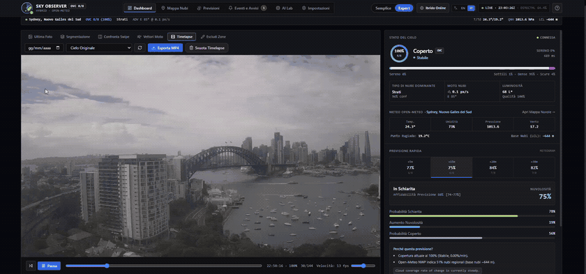
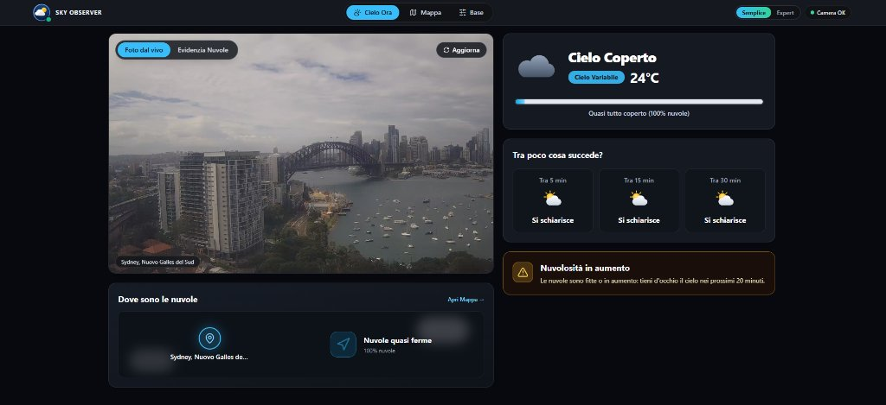
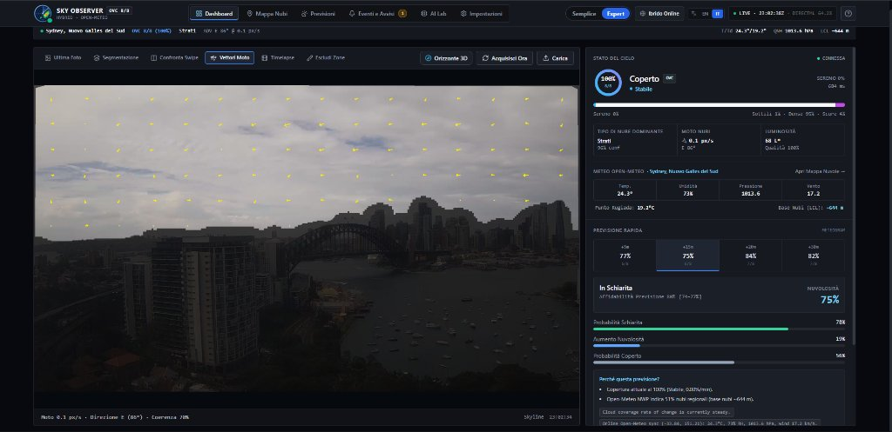
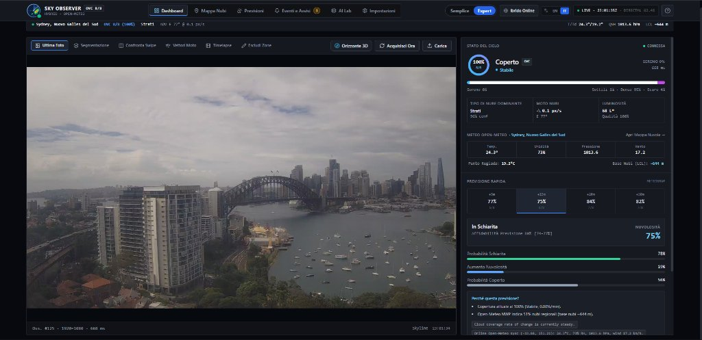
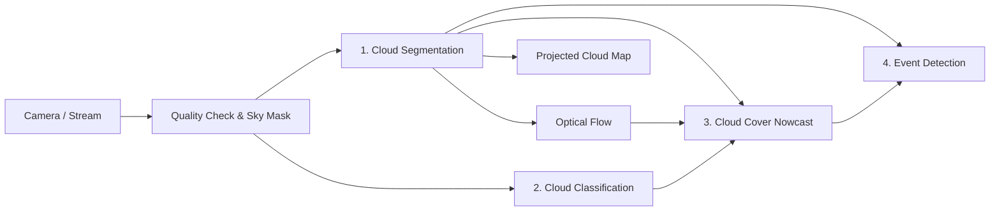

# Sky Observer

Self-hosted application that estimates cloud cover from a sky-facing camera, projects it onto a geographic cloud map, and produces short-term (5–20 min camera-only, up to 60 min with optional NWP) cloud cover nowcasts.

[](https://github.com/ak47siriano/sky-observer/actions/workflows/ci.yml)
[](LICENSE)
[](https://github.com/ak47siriano/sky-observer/releases)
[](pyproject.toml)

[English](README.md) · [Italiano](README.it.md)

---


*Dashboard in Expert mode: compare-swipe view splitting the sky segmentation mask (left: thin, dense, and dark cloud classes with buildings below the horizon masked out) and the original overcast frame (right), alongside cloud coverage telemetry and short-term cloud cover nowcast horizons.*

### Interface Walkthrough and Views


*Timelapse playback switching between original sky frames and the optical-flow cloud motion overlay (146 captured frames, foreground buildings masked out).*

<details>
<summary>Additional views (Simple mode, Projected Cloud Map, Segmentation, Motion Vectors, Raw Dashboard)</summary>

| Simple Mode | Projected Cloud Map |
| :---: | :---: |
| <br>*Simple mode: high-level sky state, 5/15/30 min summary, and map shortcut.* | <br>*Projected cloud map: camera FOV cone, zenith-clipped cloud projection, PiP sky frame, and optional RainViewer radar overlay.* |

| Sky Segmentation | Optical-Flow Motion Vectors |
| :---: | :---: |
| <br>*Full-frame cloud segmentation overlay with obstacle exclusion mask applied.* | <br>*Optical-flow velocity field computed on unmasked sky pixels.* |

| Raw Camera View (Expert Dashboard) |
| :---: |
| <br>*Expert dashboard raw camera frame with cloud cover breakdown, Open-Meteo sync, and short-term cloud cover nowcast.* |

</details>

<!-- TODO: These screenshots and demo recording were captured from a public web stream (SkylineWebcams). Replace them with captures from your own camera if you want all sample media in docs/ to be licensed directly under your chosen license (e.g. CC0 or CC-BY-4.0). -->

---

## What It Does and Does Not Do

**What it does:**
- Captures frames from LAN IP cameras (`HTTP snapshot`, `MJPEG`, `RTSP`), local USB webcams, AllSky image folders, manual uploads, or optional public web streams.
- Segments sky pixels into cloud classes on CPU without a GPU (`radiometric-physics-v1`), with optional PyTorch backends (`DeepLabV3-MobileNetV3`, `DINOv3` linear probe, `CloudSegUNet`).
- Tracks frame-to-frame cloud motion via optical flow and computes short-term cloud cover nowcasts (`+5`, `+15`, `+20` min camera-only), benchmarked continuously against a persistence baseline.
- Reprojects the camera cloud mask onto a geographic cloud map using camera azimuth, elevation, roll, FOV, and an estimated cloud-base height.
- Exposes a REST API (`/api/sky-state`), WebSocket stream (`/ws/live`), Prometheus metrics (`/metrics`), and optional Home Assistant MQTT auto-discovery.

**What it does not do:**
- It does **not** measure precipitation intensity or detect rain on its own. Precipitation overlays require enabling Hybrid Mode with an external radar provider (RainViewer or self-hosted LibreWXR).
- It does **not** replace a meteorological weather radar. The local map view is an optical sky camera projection.
- It does **not** measure cloud-base altitude from a single camera. Cloud positions on the map are geometric estimates based on an assumed height or an LCL approximation (`125 * (T - Td)`).
- It does **not** measure temperature, pressure, or humidity locally.
- It does **not** produce reliable multi-hour weather forecasts from a single narrow-FOV camera.

---

## Project Status

**Alpha / experimental.** The core observation loop works on CPU and is covered by automated tests, while neural training and some advanced features remain experimental.

- **Working and tested:** Camera ingestion (`HTTP`, `MJPEG`, `RTSP`, `USB`, `AllSky`, Demo simulation), painted/polygon obstacle exclusion masks, `radiometric-physics-v1` segmentation, optical-flow mask advection and persistence skill tracking, SQLite storage with retention and disk quota enforcement, Offline Mode default, API token authentication, REST `/api/sky-state`, and Prometheus `/metrics`.
- **Experimental or partial:** Local PyTorch fine-tuning and Location Auto-Train, `DINOv3` day/night linear probe training, `TemporalSkyConvGRU` and `SkyEventClassifier-GRU` sequence models, nighttime cloud detection, and multi-camera stereo triangulation (`POST /api/camera/stereo/triangulate` computes 3D geometry from paired azimuth/elevation inputs, without automatic cross-camera feature matching yet).

---

## Requirements

GPU acceleration (CUDA, ROCm, DirectML, or Apple MPS) is optional. Default radiometric segmentation and optical-flow nowcasting run on CPU.

| Tier | CPU | RAM | Disk | OS | GPU |
| :--- | :--- | :--- | :--- | :--- | :--- |
| Minimum | 2 cores (x86_64 or ARM64) | 4 GB | 2 GB free | Linux, Windows 10/11, macOS | None (CPU only) |
| Recommended | 4+ cores | 8 GB | 10+ GB free | Linux, Windows 10/11, macOS | Optional (4+ GB VRAM for neural fine-tuning) |

---

## Quick Start

### Docker (recommended)

```bash
cp .env.example .env
docker compose up -d --build
```

Open `http://localhost:8080`. The application starts in **Offline Mode** bound to `127.0.0.1` with a built-in **Demo Sky Simulation** source available if no physical camera is connected yet.

Notes:
- **USB / Iriun webcams (Linux only):** Standard Docker Compose supports network streams and mounted folders. To pass `/dev/video0` on Linux, run `docker compose -f docker-compose.yml -f docker-compose.usb.yml up -d`. Docker Desktop on Windows and macOS does not forward `/dev/video*` devices natively; use a network stream or native installation instead.
- **NVIDIA GPU:** Run `docker compose -f docker-compose.yml -f docker-compose.gpu.yml up -d --build` (builds with CUDA 12.4 PyTorch wheels).
- **Phone / LAN access and PWA install:** Before binding `SKYOBSERVER_HOST=0.0.0.0`, set a strong `SKYOBSERVER_API_TOKEN` in `.env` and serve over HTTPS using `docker compose -f docker-compose.yml -f docker-compose.https.yml up -d` (Caddy) or Tailscale/mkcert. See [docs/INSTALLATION.md](docs/INSTALLATION.md).

### Native installation (Linux / macOS — Bash)

```bash
python3 -m venv .venv
source .venv/bin/activate
pip install --index-url https://download.pytorch.org/whl/cpu torch torchvision
pip install -r backend/requirements.txt

cd frontend && npm ci && npm run build && cd ..

PYTHONPATH=backend uvicorn app.main:app --host 127.0.0.1 --port 8080
```

### Native installation (Windows — PowerShell)

```powershell
python -m venv .venv
.\.venv\Scripts\Activate.ps1
pip install --index-url https://download.pytorch.org/whl/cpu torch torchvision
pip install -r backend/requirements.txt

cd frontend; npm ci; npm run build; cd ..

$env:PYTHONPATH = "backend"
.\.venv\Scripts\python.exe -m uvicorn app.main:app --host 127.0.0.1 --port 8080
```

Both Docker and native commands listen on port `8080` by default.

---

## Configuration

Copy `.env.example` to `.env` to override defaults. Detailed camera, geometry, storage, and MQTT settings are stored in `config/config.yaml`.

| Variable | Default | Description |
| :--- | :--- | :--- |
| `SKYOBSERVER_OFFLINE_MODE` | `true` | Offline Mode by default. Blocks all outbound weather, geocoding, METAR, radar, and public web-stream requests. |
| `SKYOBSERVER_HOST` | `127.0.0.1` | Host interface published by Docker (or passed to `uvicorn`). Keep `127.0.0.1` unless securing LAN access. |
| `SKYOBSERVER_PORT` | `8080` | HTTP port for both API and web UI. |
| `SKYOBSERVER_API_TOKEN` | *(empty)* | Shared token enforcing authentication on `/api/*`, `/ws/live`, and `/metrics`, plus confirmation headers on destructive routes. |
| `SKYOBSERVER_SOURCE_ALLOWLIST` | *(empty)* | Optional comma-separated list of allowed hosts, domains, or CIDRs for camera URLs (SSRF restriction). |
| `SKYOBSERVER_DEVICE` | `auto` | Compute device (`auto`, `cpu`, `cuda`, `rocm`, `directml`, `mps`). |
| `SKYOBSERVER_DATA_DIR` | `/data` (Docker) / `./data` (native) | Directory for SQLite DB, images, masks, timelapses, datasets, and local `.pmtiles`. |
| `SKYOBSERVER_VIDEO_DEVICE` | `/dev/video0` | Linux V4L2 device used by `docker-compose.usb.yml`. |
| `SKYOBSERVER_LAN_HOST` | `localhost` | LAN IP or hostname for the Caddy TLS certificate in `docker-compose.https.yml`. |

**Offline Mode vs. Hybrid Mode:**
- **Offline Mode (`SKYOBSERVER_OFFLINE_MODE=true`, default):** Zero outbound network traffic. The cloud map renders a local coordinate grid or user-installed Protomaps `.pmtiles` files under `data/map_tiles/`. Cloud cover nowcasts are limited to camera-only horizons (`+5`, `+15`, `+20` min).
- **Hybrid Mode (`SKYOBSERVER_OFFLINE_MODE=false`):** Enables optional Open-Meteo weather/LCL/NWP data (extending horizons to `+30`/`+60` min), optional RainViewer past precipitation radar tiles (or self-hosted LibreWXR), online map tiles, nearby METAR verification, and public `web_stream` capture.

---

## How It Works



1. **Cloud Segmentation:** Takes a sky frame and static obstacle mask and outputs a pixel-level sky/cloud class map (internal 5 classes or reduced 3-class projection: `clear_sky`, `cloud`, `thick_cloud`, plus `255` non-sky exclusion). Runs out of the box via deterministic `radiometric-physics-v1` on CPU, with optional `DeepLabV3-MobileNetV3`, `DINOv3` linear probe, or `CloudSegUNet` neural checkpoints. Used to calculate cloud cover percentage and build the projected cloud map.
2. **Cloud Classification:** Takes the sky frame together with radiometric, coverage, and texture features and outputs a cloud type probability distribution (reduced 5-class SWIMCAT-aligned macro taxonomy plus detailed heuristic genera and optional sky-state tags such as `fog`, `rain`, `contrails`, returning `unknown` below confidence threshold). Used to describe sky structure and inform default cloud-base altitude heuristics when no NWP data is available.
3. **Cloud Cover Nowcasting:** Takes recent segmentation masks, optical-flow motion fields, and chronological feature history and outputs projected cloud cover percentages for `+5`, `+15`, and `+20` min (`+30`/`+60` min only with Open-Meteo NWP). Combines semi-Lagrangian optical-flow mask advection (with uncertainty percentiles `p10`–`p90`) and an optional experimental `TemporalSkyConvGRU`, always scored against a persistence baseline.
4. **Event Detection:** Takes frame-to-frame coverage, luminance, and motion changes and outputs operational and sky alerts (such as rapid cloud increase, sky clearing, darkening, or camera obstruction). Uses deterministic rules with optional user feedback (confirm, false alarm, or report missed event) and an optional experimental `SkyEventClassifier-GRU`.

Implementation details, tensor shapes, and storage layout are documented in [docs/ARCHITECTURE.md](docs/ARCHITECTURE.md).

---

## Accuracy and Evaluation

Evaluation is run with `PYTHONPATH=backend python scripts/evaluate.py` (whole-day chronological splits and explicit naive baselines) and `PYTHONPATH=backend python scripts/evaluate_nowcast.py --from-db`.

**Current status:** Real-world evaluation on a human-labeled local camera Golden Set is **not yet completed**. The numbers below come only from the bundled synthetic regression sequences included in the repository; they serve as a CI regression check and must not be read as real-camera field accuracy.

| Task | Evaluation Set (current) | Model | Measured Result | Naive Baseline |
| :--- | :--- | :--- | :--- | :--- |
| Segmentation | `bundled_synthetic_sky_18f` (`n=18`) | `radiometric-physics-v1` | Binary mIoU `0.8725`, Cover MAE `5.02%` | Fixed R/B: mIoU `0.8628`, MAE `7.09%`; Otsu: mIoU `0.8375`, MAE `7.78%` |
| Classification | `bundled_synthetic_sky_18f` (held-out day, `n=6`) | `physical-heuristic-v1` | Accuracy `0.6667`, Macro F1 `0.5714` | 12-feature kNN: Acc `0.8333`, F1 `0.7778`; Majority: Acc `0.1667` |
| Cloud cover nowcast (+5 min) | `bundled_panoramic_cloud_front_14f` (`n=11`) | Hybrid advection | MAE `6.49%`, Skill `+0.48` | Persistence: MAE `12.59%`; Linear trend: MAE `5.92%` (`+0.53`) |
| Cloud cover nowcast (+15 min) | `bundled_panoramic_cloud_front_14f` (`n=7`) | Hybrid advection | MAE `26.37%`, Skill `+0.36` | Persistence: MAE `41.27%`; Linear trend: MAE `16.77%` (`+0.59`) |
| Cloud cover nowcast (+20 min) | `bundled_panoramic_cloud_front_14f` (`n=5`) | Hybrid advection | MAE `37.66%`, Skill `+0.31` | Persistence: MAE `54.58%`; Linear trend: MAE `23.69%` (`+0.57`) |

<!-- TODO: Build a 150–300 frame human-labeled Golden Set from your own camera with scripts/build_golden_set.py, run scripts/evaluate.py --datasets-dir data/datasets, and replace/supplement the synthetic rows above with real-camera and public dataset (SWIMSEG/SWINySEG) results. -->

Skill score is defined as `1 - MAE_model / MAE_persistence` (values `<= 0` mean no improvement over persistence). Full stratified metrics and event evaluation results are in [docs/MODEL_CARD.md](docs/MODEL_CARD.md).

---

## Known Limitations

- **Single-camera cloud-base height uncertainty:** One camera cannot measure cloud altitude. Any error in the assumed or LCL-estimated cloud base scales projected horizontal distances linearly (`d = H * tan(zenith)`). Error grows rapidly toward the horizon; projection is capped at `<= 75 deg` zenith (`>= 15 deg` elevation) and fades opacity with uncertainty. Measuring real cloud-base height requires two spaced cameras (`POST /api/camera/stereo/triangulate`).
- **Narrow-FOV advection horizons:** With a typical ~70 deg smartphone lens, clouds cross the field of view in 5–15 minutes. Horizons where `>= 70%` of clouds leave the FOV or where historical skill does not beat persistence are marked `low_reliability`.
- **Night, twilight, glare, and lens contamination:** Nighttime cloud detection depends on local sky glow or visible stars and has lower reliability. Direct sun glare, twilight color shifts, indoor window reflections, and water droplets on the lens degrade segmentation and classification (flagged by the QC module when detected, but not eliminated).
- **Smartphone auto-exposure and auto-white-balance:** Consumer cameras continuously shift exposure and white balance, which alters radiometric R/B and luminance features. Bounded AE/AWB normalization reduces jitter but cannot match a locked manual exposure camera.
- **Experimental Auto-Train:** Unsupervised self-training can drift over time. Location Auto-Train excludes locked Golden Set frames, caps pseudo-labels at 50% of a training batch, and rejects checkpoints that regress in any sky condition category, but still requires human review before trusting in production.

---

## Security

- **Do not expose Sky Observer directly to the public Internet.** It is designed for localhost or a trusted private LAN / VPN (such as Tailscale or WireGuard).
- By default, Docker binds only to `127.0.0.1:8080`.
- Before binding to a LAN interface, set `SKYOBSERVER_API_TOKEN`, configure `SKYOBSERVER_SOURCE_ALLOWLIST` if restricting camera hosts, and use HTTPS (`docker-compose.https.yml` or a reverse proxy).
- See [SECURITY.md](SECURITY.md) for the threat model, authentication headers, SSRF protections, and vulnerability reporting.

---

## Documentation

- [docs/INSTALLATION.md](docs/INSTALLATION.md) — Hardware tiers, Docker overrides (GPU, USB, Caddy HTTPS), native setup, and outdoor camera notes
- [docs/ARCHITECTURE.md](docs/ARCHITECTURE.md) — Pipeline layers, pluggable segmentation backends, and SQLite/disk storage layout
- [docs/MODEL_CARD.md](docs/MODEL_CARD.md) — Model details, anti-drift gates, reproducible evaluation tables, and literature references
- [docs/API.md](docs/API.md) — REST endpoints, WebSocket (`/ws/live`), Home Assistant, and Prometheus `/metrics`
- [docs/DATASETS.md](docs/DATASETS.md) — Public datasets, class-mapping tables, and import directory formats
- [docs/TRAINING.md](docs/TRAINING.md) — Local fine-tuning, Golden Set creation, and Auto-Train workflow
- [docs/TROUBLESHOOTING.md](docs/TROUBLESHOOTING.md) — Camera connection, GPU fallback, and common runtime errors
- [SECURITY.md](SECURITY.md) — Network threat model, token authentication, and credential handling
- [CHANGELOG.md](CHANGELOG.md) — Version history

---

## Contributing

Contributions, bug reports, and evaluation datasets are welcome. See [CONTRIBUTING.md](CONTRIBUTING.md) for development setup and code style rules.

When opening a bug report, include:
- Sky Observer version or commit hash (`git rev-parse --short HEAD`)
- Operating system and installation method (Docker Compose or native Python)
- Camera source type (`http_snapshot`, `mjpeg_stream`, `rtsp`, `webcam_device`, `allsky_folder`, or `web_stream`)
- Relevant backend logs and steps to reproduce

---

## License and Credits

- **Source code:** Licensed under the [MIT License](LICENSE).
- **Datasets and trained weights:** Sky Observer includes documentation and format adapters for public sky/cloud datasets (including **SWIMSEG**, **SWINSEG**, **SWINySEG**, **WSISEG**, **SWIMCAT**, **CCSN**, **MGCD/GCD**, and **LenghuSky-8**). These datasets are **not** bundled in this repository and carry their own licenses (often academic or non-commercial). Any model weights trained on third-party datasets or built on third-party backbones (such as **DINOv3**) inherit the upstream license restrictions; verify each source license before redistributing weights. See [docs/DATASETS.md](docs/DATASETS.md).
- **External service attributions (only used when Hybrid Mode is enabled):**
  - Weather and geocoding data: [Open-Meteo](https://open-meteo.com/) (CC BY 4.0)
  - Map tiles: [OpenStreetMap](https://www.openstreetmap.org/copyright) contributors (ODbL), Esri World Imagery / Dark Gray Canvas, or user-supplied local [Protomaps](https://protomaps.com/) `.pmtiles` archives
  - Optional precipitation radar overlay: [RainViewer](https://www.rainviewer.com/api.html) (past radar frames, free-tier limits apply) or user-configured self-hosted LibreWXR
  - Optional METAR comparison: NOAA Aviation Weather Center
- **Example screenshots:** <!-- TODO: State the license of docs/screenshots/*.png once replaced with original images captured by your own camera. -->
