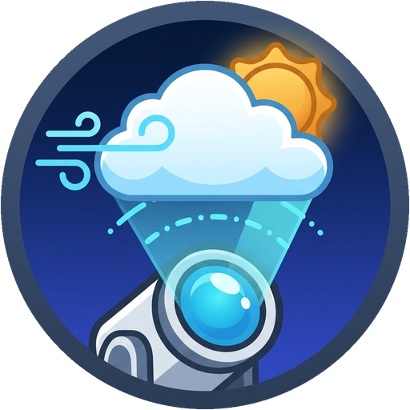
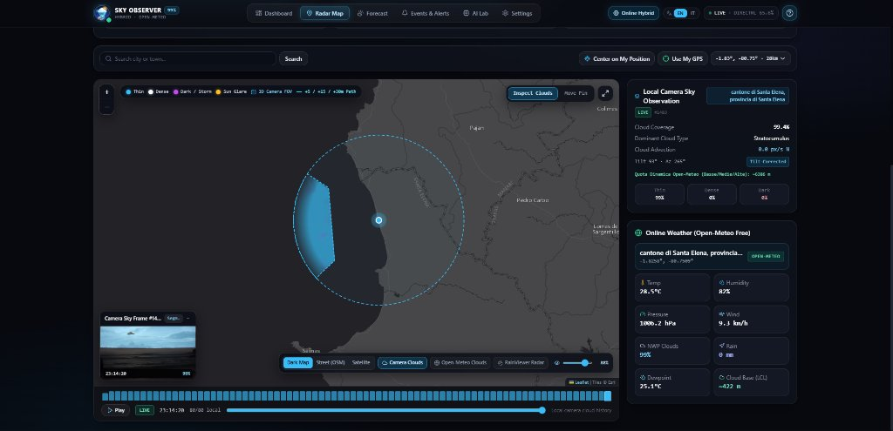
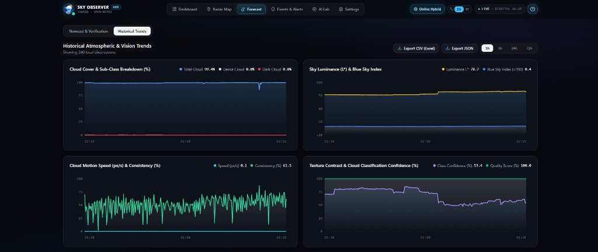
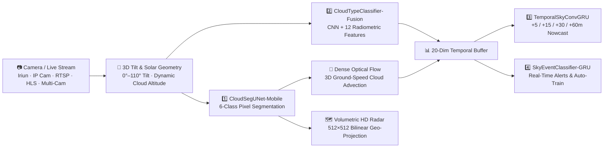

<div align="center">



# Sky Observer — Local AI Sky Observatory, 3D Cloud Radar & Nowcasting

**Turn any smartphone camera (`Iriun` / `IP Webcam` / `RTSP`), USB camera, or public live webcam (`HLS` / `SkylineWebcams`) into a real-time local AI meteorological observatory.**

[](#)
[](#-the-4-local-ai-models)
[](#-hardware-requirements--gpu-acceleration)
[](#-database--storage-architecture)
[](#-key-features)
[](#-quick-start)
[](#)

</div>

---

## 📖 Overview

**Sky Observer** is a self-hosted, privacy-first **AI Sky Observatory & Short-Term Nowcasting Platform** with a modern **atmospheric glassmorphic UI** and an **immersive Windy-style 3D Geo-Radar**.

It captures live sky frames from local cameras or public live streams, corrects for **3D camera mounting tilt (`0°–110°`), compass azimuth, and roll**, runs a **4-stage neural & deterministic pipeline**, projects high-contrast Windy-style clouds onto a **Georeferenced Radar Map** using **dynamic cloud-base altitude**, exports **HUD-overlaid timelapses**, and forecasts short-term weather evolution (`+5m`, `+15m`, `+20m` camera-only, or up to `+60m` with Open-Meteo).

It runs **100% offline** with zero external API keys required, or in **Online Hybrid Mode** fusing local camera vision with free **Open-Meteo NWP** multi-layer cloud telemetry and **RainViewer** precipitation radar.

---

## 🖼️ Live UI Showcase (Public Coastal Stream — Cantone di Santa Elena, `-1.83°, -80.75°`)

### 1. Live Dashboard & Short-Term Nowcast
Real-time camera ingestion, radial cloud coverage gauge (`99%` Overcast, `Stratocumulus`), **Current Sky** breakdown (`Thin` / `Dense` / `Dark`), **Short-Term Nowcast** (`+5m` / `+15m` / `+20m` / `+30m`), **Open-Meteo** local sync (`LCL` cloud base `~422 m`), and **Location Auto-Train** status strip:


### 2. Georeferenced Volumetric Cloud Radar
Projection of local camera cloud segmentation onto dark Leaflet map tiles with the pulsing camera pin, 3D FOV cone, **Windy-style** volumetric cloud palette (`Thin` cyan / `Dense` white / `Dark` storm purple / `Sun Glare` amber), floating glass dock (`Camera Clouds`, `Open-Meteo Clouds`, `RainViewer Radar`), timeline scrubber, and Picture-in-Picture (PiP) sky frame:



### 3. Historical Atmospheric & Vision Trends
Multi-panel historical charts tracking **Cloud Cover & Sub-Class Breakdown**, **Sky Luminance (`L*`) & Blue Sky Index**, **Cloud Motion Speed (`px/s`) & Consistency**, and **Texture Contrast & Classification Confidence**, with `1h`/`6h`/`24h`/`72h` windows and **CSV / JSON** export:



---

## 🧠 Architecture & Processing Pipeline



---

## ✨ Key Features

### 🛰️ Meteorological Workstation UI, METAR/Oktas & Offline PWA
* **Neutral Charcoal Workstation Interface**: Distraction-free `#101216` / `#16191F` precision slate layout inspired by **Windy** and **MeteoBlue** — `100vh` locked Dashboard with a live **METAR/SYNOP station ticker**, **WMO Oktas (`0/8–8/8`) & Sky Condition codes (`SKC`, `FEW`, `SCT`, `BKN`, `OVC`)**, **4-horizon Meteogram strip**, flat hairline telemetry tables, live **UTC station clock**, and instant **English / Italiano** language switch.
* **WebSocket-First Live Sync & Built-In Manual (`?`)**: Auto-reconnecting `/ws/live` telemetry push (with 10s fallback polling only when disconnected) and a context-aware help modal in the header.
* **Offline-Ready Mobile PWA (`sw.js` v3)**: Tiered caching for immutable Vite assets, bounded map-tile cache (`250` tiles), offline HTML fallback, `manifest.webmanifest`, and a dedicated **mobile bottom tab bar**.

### 🗺️ Windy-Style Interactive 3D Geo-Radar & Robust Motion Tracking
* **Fullscreen Immersive Map & Telemetry Sidebar**: Tall interactive Leaflet radar with 1-click **Fullscreen**, **Dark / Street (OSM) / Satellite** switcher, layer toggles, **Cloud Opacity slider (`25%–100%`)**, enlarged **PiP Sky Monitor**, and a modular **`RadarTelemetrySidebar`** showing **Dewpoint Spread ($\Delta T = T - T_d$)**, **LCL Cloud Base**, and **2nd-Deck Cloud Advection**.
* **480×360 CLAHE + MAD-Filtered Optical Flow (`motion.py`)**: Multi-scale Farneback + Lucas-Kanade + masked Phase Correlation with **CLAHE exposure stabilization**, `5×5` sky-boundary erosion, **MAD outlier rejection**, and **dual-deck cloud layer separation** (`secondary_layer`) for upper vs. lower cloud drift.
* **High-Contrast Volumetric Cloud Rendering (`512×512`)**: Distinct Windy-style colors (**Electric Cyan** Thin, **Bright White** Dense, **Storm Violet-Magenta** Dark/Storm, **Solar Gold** Sun Glare) modulated by local sky luminance/CLAHE relief and bilinear geo-warping.
* **Dynamic Cloud Altitude (Online & Offline)**: Automatically computes cloud altitude from **Open-Meteo Low/Mid/High multi-layer cloud decks + Magnus-Tetens LCL** when online, or dynamically from **local Vision AI cloud morphology** (`Cirrus`, `Altocumulus`, `Cumulus`, `Cumulonimbus`, `Stratus`) when offline.
* **Multi-Camera 360° Radar Fusion & Tile Cache**: Connect secondary cameras pointing in complementary directions and fuse their live cloud projections onto the same radar map, or pre-cache local map tiles for 100% offline radar use.

### 📐 3D Camera Tilt Calibrator (`0°–110°`) & Flexible Video Sources
* **Wide-Range Tilt Calibration**: Interactive 2D side-profile & compass calibrator supporting **zenith (`0°`), tilted, horizontal (`90°`), and downward-angled panoramic webcams (up to `110°` / `El -20°`)**, plus live 3D horizon (`0°`), elevation iso-curves, and NOAA sun position overlay.
* **Any Camera or Live Web Stream**: Supports Android **Iriun Webcam**, **IP Webcam** (`HTTP Snapshot` / `MJPEG`), **RTSP**, local USB cameras, file uploads, and **Public Web Live Streams (`web_stream`)** including direct `.m3u8` HLS playlists and **SkylineWebcams** pages.
* **Freehand Exclusion Mask Painter**: Paint out roofs, trees, poles, ocean/buildings, or camera watermarks so only pure sky is analyzed.

### 🎬 Meteo HUD Timelapse, Auto Daily Digest & Analytics Export
* **Timelapse with Burned-in Weather HUD**: Export `.mp4` timelapses (Raw, Segmentation, or Motion layers) with a clean HUD displaying timestamp, cloud coverage %, cloud genus, advection vector, and Open-Meteo temperature.
* **Automatic Sunset Daily Sky Digest**: Automatically generates a daily summary video (`YYYY-MM-DD_daily.mp4`) after local sunset.
* **CSV / JSON Export & AI Forecast MAE Trend**: Download the full historical telemetry & verification series as **CSV** or **JSON** for Excel/Python, and track forecast **Mean Absolute Error (MAE)** over time to watch local Auto-Train improve accuracy.

### 🔄 Self-Learning AI Lab & Storage Management
* **Location Auto-Train**: Automatically labels high-confidence local sky observations and user-confirmed alerts to reinforce all 4 PyTorch models on your camera lens while mixing baseline replay samples to prevent forgetting.
* **Model Registry, Rollback, Pruning & Instant Stop**: Versioned model checkpoints, 1-click rollback, bulk standby pruning (*Keep Active* / *Keep Active + 1 Backup*), instant active-job stop, and granular storage cleanup with SQLite `VACUUM`.

---

## 🤖 The 4 Local AI Models

Every captured sky observation passes through four specialized lightweight PyTorch models (`< 1 GB VRAM` on GPU, fast on CPU):

| # | Model Family & Architecture | Input $\rightarrow$ Output | Role in Sky Observer | Validation Metrics |
| :--- | :--- | :--- | :--- | :--- |
| **1** | **Segmentation**<br>`CloudSegUNet-MobileNetV3` / `EfficientNetB0` | $384\text{–}512$ RGB Sky Frame $\rightarrow$ **5-class pixel map** (`Clear`, `Thin`, `Dense`, `Dark`, `Sun_Glare` + `Not_Sky=255` ignore mask) | Computes **Cloud Coverage %**, renders high-contrast overlays, $3\times3$ grid, and **projects detailed clouds onto the 3D Radar Map**. Supports 2-phase training (SWINySEG $\rightarrow$ Almería/Clouds-1500). | `val_miou` ($0 \rightarrow 1$)<br>`val_pixel_acc` ($0 \rightarrow 1$) |
| **2** | **Classification**<br>`CloudTypeClassifier-Fusion` | $224\times224$ RGB + **18 tabular features** (5 Stage-1 fractions, solar elevation, RBR, $R-B$, GLCM) $\rightarrow$ **11 WMO Genera** (or 6 grouped) | Identifies WMO cloud genera (supporting TJNU MGCD/GCD) and informs offline dynamic cloud altitude. | `val_accuracy` ($0 \rightarrow 1$)<br>`val_macro_f1` ($0 \rightarrow 1$) |
| **3** | **Temporal Nowcast**<br>`TemporalSkyConvGRU` | Chronological $T\times20$ visual + optical-flow sequence $\rightarrow$ **3 Camera-Only Horizons** (`+5m`, `+15m`, `+20m`) | Predicts short-term cloud cover %, clearing, increasing, overcast, darkening, and storm signals (extends to `+30m/+60m` when Open-Meteo is enabled). | `val_mae_pct` (lower is better) |
| **4** | **Events & Alerts**<br>`SkyEventEngine` + `SkyEventClassifier-GRU` | Stage 1 deltas + Stage 2 WMO class + Stage 3 trend $\rightarrow$ **8 Weather & Operational Events** | Hybrid deterministic/neural alert engine with photo snapshots; Confirm/Reject feedback reinforces **Location Auto-Train**. | `val_accuracy` & `val_macro_f1` |

---

## 💻 Hardware Requirements & GPU Acceleration

Sky Observer automatically detects your OS, CPU, RAM, and GPU and offers **4 Hardware Performance Presets** (`Low-End PC`, `Balanced`, `High-End GPU`, `Ultra`) in **AI Lab**:

| Tier | OS / Platform | CPU & RAM | GPU | Recommended Profile |
| :--- | :--- | :--- | :--- | :--- |
| **Minimum (Low-End / Mini-PC)** | Linux (`x86_64`/`ARM64`), Windows 10/11, macOS | **2+ Cores** · **4 GB RAM** | None (**100% CPU**) | `CPU Only` · `256×256` · `Batch 1` |
| **Recommended (Balanced)** | Linux, Windows 10/11, macOS | **4+ Cores** · **8 GB RAM** | Optional GPU (`2–4 GB VRAM`) or CPU | `Auto` · `384×384` · `Batch 2` |
| **High-End (Desktop GPU)** | Linux, Windows 10/11, Apple Silicon | **6–8+ Cores** · **16 GB RAM** | **NVIDIA CUDA**, **AMD ROCm**, **AMD/Intel DirectML**, or **Apple MPS** | `Auto` · `384–512` · `Batch 4` |
| **Ultra (Workstation)** | Linux, Windows 10/11 | **12+ Cores** · **32+ GB RAM** | **NVIDIA CUDA** or **AMD ROCm** (`12+ GB VRAM`) | `CUDA / ROCm` · `768×768` · `FP16` |

### Optional GPU Acceleration Backends
* **NVIDIA GPU (Windows / Linux — CUDA)**: `pip install torch torchvision --index-url https://download.pytorch.org/whl/cu124`
* **AMD Radeon GPU (Linux — ROCm)**: `pip install torch torchvision --index-url https://download.pytorch.org/whl/rocm6.2`
* **AMD Radeon / Intel Arc GPU (Windows — DirectML)**: `pip install torch-directml` *(automatically uses DirectML for fast live inference and CPU for TDR-safe training on shared display GPUs)*
* **Apple Silicon (M1–M4)**: Automatic native PyTorch **MPS** support.

---

## 🗄️ Database & Storage Architecture

* **`data/db/skyobserver.db` (SQLite 3 in WAL mode + SQLAlchemy 2.0)**:
  - Concurrent non-blocking reads/writes across **8 tables**: `observations`, `forecasts`, `forecast_verifications`, `events`, `datasets`, `dataset_items`, `training_sessions`, `model_registry`.
* **Local Data Directories (`data/`)**:
  - `images/raw/` & `images/processed/` — Captured frames, segmentation masks & motion overlays
  - `models/` — Versioned PyTorch `.pt` checkpoints
  - `datasets/` — Local & imported datasets (`SWIMSEG`, `SWINySEG`, `CCSN`, auto-labeled sky frames)
  - `timelapse/` — HUD-overlaid `.mp4` timelapses & daily sunset digests (`YYYY-MM-DD_daily.mp4`)
  - `map_tiles/` — Cached offline Leaflet map tiles
  - `config/config.yaml` — Validated YAML configuration

---

## 🚀 Quick Start

### Option 1: Docker Compose (Recommended)

```bash
docker compose up -d --build
```
Open **`http://localhost:8080`** (or `http://<your-lan-ip>:8080` from your phone to install the PWA).

> Pre-built single-image deployment via Docker Hub is also included in [`docker-compose.hub.yml`](docker-compose.hub.yml) and [`scripts/push-dockerhub.ps1`](scripts/push-dockerhub.ps1).

### Option 2: Local Native Setup (Windows / Linux / macOS)

```powershell
# 1. Python backend
python -m venv .venv
.\.venv\Scripts\Activate.ps1
pip install -r backend/requirements.txt

# 2. React frontend
cd frontend
npm install
npm run build
cd ..

# 3. Bootstrap & train the 4 local baseline PyTorch models (optional, ~30s)
$env:PYTHONPATH = "backend"
.\.venv\Scripts\python.exe scripts/train_baseline.py

# 3b. Optional: import public datasets (Almería ASI, SWINySEG, Clouds-1500, TJNU MGCD/GCD)
.\.venv\Scripts\python.exe scripts/prepare_datasets.py --dataset almeria_asi --path data/datasets/almeria/kontas_2017

# 3c. Optional: high-confidence pseudo-labeling & self-supervised (+5/+15/+20m) sequences from webcam
.\.venv\Scripts\python.exe scripts/pseudo_label_webcam.py --min-conf 0.78 --register
.\.venv\Scripts\python.exe scripts/build_temporal_selfsupervised.py --source data/timelapse/daily.mp4 --frame-interval-sec 60

# 4. Launch server (bind 0.0.0.0 to also access from phone/LAN)
.\.venv\Scripts\python.exe -m uvicorn app.main:app --host 0.0.0.0 --port 8081
```
Open **`http://localhost:8081`** (or `http://<your-lan-ip>:8081` on mobile).

---

## 🧪 Running Tests

```powershell
$env:PYTHONPATH = "backend"
.\.venv\Scripts\pytest.exe backend/tests -v
```

---

## 📄 Documentation Index

* [`ARCHITECTURE.md`](ARCHITECTURE.md) — System design, vision pipeline & 3D spherical projection math
* [`MODEL_CARD.md`](MODEL_CARD.md) — Neural architectures, tensors & evaluation metrics
* [`TRAINING.md`](TRAINING.md) — Local fine-tuning, dataset import (`SWIMSEG`, `CCSN`) & Auto-Train
* [`API.md`](API.md) — REST & WebSocket (`/ws/live`) API reference
* [`INSTALLATION.md`](INSTALLATION.md) — Hardware tiers, Android camera setup & GPU backends
* [`TROUBLESHOOTING.md`](TROUBLESHOOTING.md) — Camera diagnostics, DirectML/CUDA fallback & common fixes
